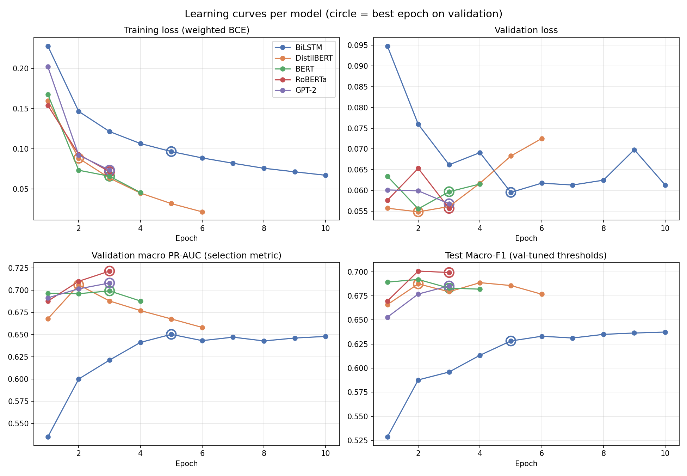
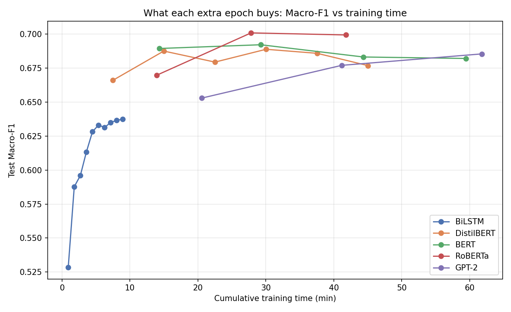
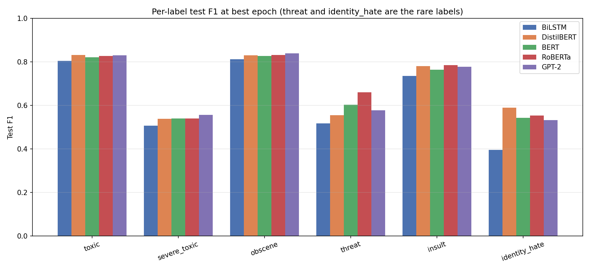
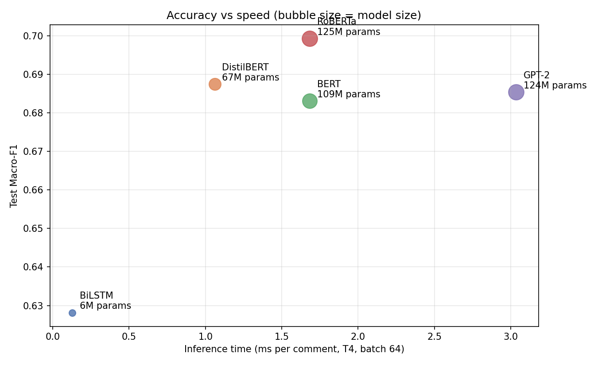

# Toxic Comment Detection — Sequence Models vs Transformers

**MAT339 Transformer Models & Sequence Learning · MSc Data Science, SASTRA Deemed to be University**
Author: Priyadharshini Sivasankar

A comparative study of five models for **multi-label toxic comment classification** on the Jigsaw Toxic Comment dataset
(6 labels: toxic, severe_toxic, obscene, threat, insult, identity_hate).

| Model | Type | Test Macro-F1 | Test Micro-F1 | ROC-AUC | PR-AUC | Inference (ms/comment) | Size (MB) |
|---|---|---|---|---|---|---|---|
| **RoBERTa** | Encoder transformer | **0.699** | **0.792** | 0.989 | **0.740** | 1.68 | 476 |
| DistilBERT | Encoder transformer (distilled) | 0.687 | 0.789 | 0.989 | 0.735 | 1.06 | 255 |
| GPT-2 | Decoder transformer | 0.685 | 0.790 | 0.989 | 0.738 | 3.04 | 475 |
| BERT-base | Encoder transformer | 0.683 | 0.779 | 0.987 | 0.715 | 1.68 | 418 |
| BiLSTM | Recurrent sequence model | 0.628 | 0.755 | 0.984 | 0.656 | **0.13** | **24** |

## Key findings
- **RoBERTa** gave the best macro-F1 and PR-AUC overall.
- **DistilBERT** came within about 0.01 macro-F1 of RoBERTa at roughly half the size and the fastest transformer inference, so it gives the best accuracy for its cost.
- **GPT-2** (decoder-only) was competitive on accuracy but was the slowest to train and to run.
- **BiLSTM** trailed by about 0.07 macro-F1, mainly on rare labels (threat, identity_hate). It is still about 8× faster than DistilBERT and about 10× smaller.
- Models were trained for several epochs, and the best epoch was chosen by validation macro PR-AUC. Per-label decision thresholds were tuned on the validation set.

## Figures
| | |
|---|---|
|  |  |
|  |  |

## Files
- `Toxic_Comment_Transformer_Comparison.ipynb`: full Colab notebook (preprocessing, training, evaluation)
- `Project_Report.docx`: end-semester project report
- `results/`: comparison tables, per-epoch metrics, per-model final metrics (JSON) and figures

**Tech:** Python · PyTorch (BiLSTM) · Hugging Face Transformers · scikit-learn · Matplotlib · Google Colab
